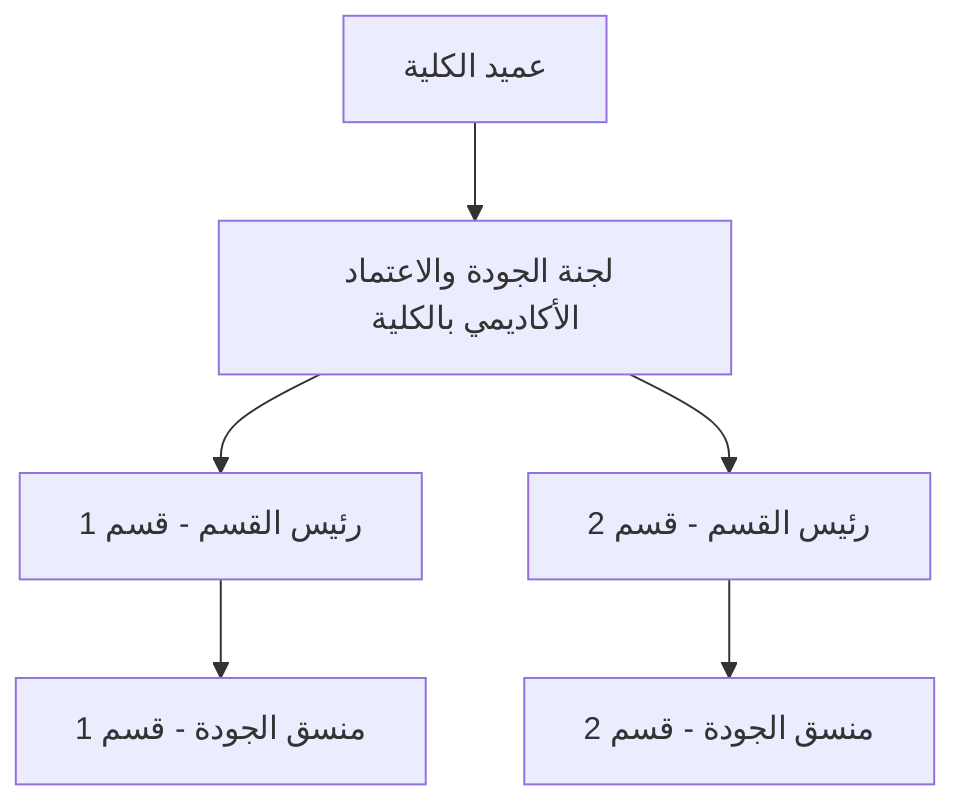

# الهيكل التنظيمي للاعتماد الأكاديمي في الكلية

هيكل بسيط وواضح يوضح مسار العمل والمسؤوليات بين عمادة الكلية، لجنة الجودة، رؤساء الأقسام، ومنسقي الجودة في الأقسام.

## المخطط الهرمي



## المستويات والمسؤوليات

### 1. عميد الكلية
- الاعتماد النهائي للخطط والتقارير المتعلقة بالاعتماد الأكاديمي.
- متابعة الأداء العام لملف الاعتماد على مستوى الكلية.

### 2. لجنة الجودة والاعتماد الأكاديمي بالكلية
- تنسيق العمل بين جميع الأقسام الأكاديمية.
- مراجعة وتجميع التقارير الواردة من الأقسام.
- رفع التقارير المجمّعة لعميد الكلية ولجهة الاعتماد الخارجية عند الحاجة.

### 3. رئيس القسم
- المسؤول الأول عن ملف الاعتماد الأكاديمي داخل القسم.
- اعتماد التقارير والوثائق التي يعدّها منسق الجودة قبل رفعها للجنة الجودة بالكلية.
- الإشراف المباشر على منسق جودة القسم ومتابعة عمله.
- تمثيل القسم في اجتماعات لجنة الجودة بالكلية.

### 4. منسق جودة القسم
- المتابعة اليومية لتنفيذ معايير الاعتماد داخل القسم.
- جمع الأدلة والوثائق الداعمة (Evidence) من أعضاء هيئة التدريس.
- إعداد التقارير الدورية ورفعها لرئيس القسم للاعتماد.
- التنسيق مع أعضاء هيئة التدريس لتوفير المطلوبات في مواعيدها.

## مسار التقارير (تسلسل العمل)

```
منسق جودة القسم  →  رئيس القسم (اعتماد)  →  لجنة الجودة بالكلية (مراجعة وتجميع)  →  عميد الكلية (اعتماد نهائي)
```

## جدول ملخّص

| الجهة | الدور الأساسي | ترفع التقارير إلى |
|---|---|---|
| منسق جودة القسم | تنفيذ ومتابعة يومية وجمع الأدلة | رئيس القسم |
| رئيس القسم | اعتماد عمل القسم والإشراف على المنسق | لجنة الجودة بالكلية |
| لجنة الجودة بالكلية | تنسيق ومراجعة على مستوى الكلية | عميد الكلية |
| عميد الكلية | الاعتماد النهائي | جهة الاعتماد الخارجية (إن وجدت) |
